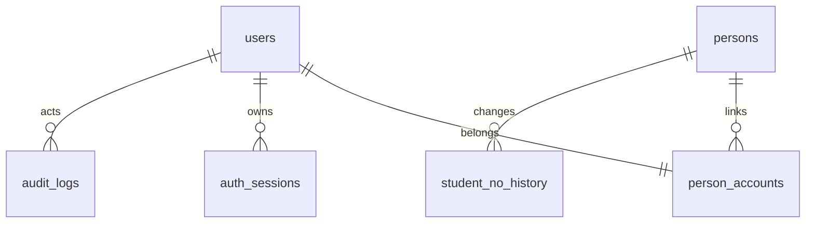

# 首批数据库说明

迁移文件：`migrations/000001_identity.up.sql`；期望版本 1。使用 MySQL 8、InnoDB、utf8mb4、BIGINT UNSIGNED 主键，应用写入 UTC DATETIME(6)。数据库实际迁移及约束验收尚未运行，见 CHANGELOG.md。

## 数据关系

所有历史相关外键使用 RESTRICT，禁止通过级联删除账号、身份、会话或历史记录。首批没有物理删除接口。

## 表与约束

| 表 | 关键字段 | 索引与用途 |
| --- | --- | --- |
| users | username、password_hash、account_type、global_role、status、token_version、created_at/updated_at | username ASCII 二进制唯一索引；规范化由服务端执行；改密增加版本使旧 JWT 失效 |
| persons | display_name、student_no、student_no_status、created_at/updated_at | student_no 可空唯一索引，多个 NULL 合法；保留前导零；状态与是否为空具有 CHECK 约束 |
| person_accounts | user_id、person_id、created_at | user_id 主键保证每账号一个当前身份，person_id 索引允许同一身份关联多个账号 |
| student_no_history | person_id、old/new_student_no、old/new_status、actor_user_id、reason、created_at | (person_id, created_at, id) 支持身份历史顺序查询；初次填写学号也保留记录 |
| auth_sessions | jti_hash、user_id、token_version、expires_at、revoked_at、created_at | jti_hash 唯一；用户与有效期、全局有效期索引；只存 SHA-256 摘要，不存完整 JWT |
| audit_logs | actor_user_id、action、object_type/object_id、request_id、details、created_at | 操作者/时间、对象/时间复合索引；details 为受控 JSON，不存密码、JWT、密钥 |

当前账号类型预留 permanent/contest，公共注册只创建 permanent；角色为 user/super_admin；状态为 active/disabled/retired。比赛管理员将通过比赛授权关系实现。

学号状态：none（空）、pending（待审核）、verified（已审核）、rejected（驳回）。学号归属 persons，不重复存入 users。注册时空白学号转 NULL，非空去首尾空白后设 pending；同学号不会自动匹配、合并或关联身份。

## 事务边界

- **注册**：创建 person → user → person_accounts → 可选初次学号历史 → 审计 → 提交。任一失败回滚；唯一冲突返回 409。并发唯一性以数据库约束兜底。
- **登录**：查找并验证密码后，事务锁定 user，复查状态及 token_version，插入会话与登录审计后提交。签名后的 JWT 只有在会话提交后才返回。
- **退出**：锁定 user，撤销当前 jti 对应会话并记录审计，一起提交。重复撤销不重复写成功审计。
- **改密**：锁定 user 并验证当前会话仍有效，更新哈希与 token_version、撤销该账号全部有效会话、写审计，一起提交。用户锁优先于会话锁，保持统一锁顺序。
- **管理员初始化**：不存在时使用同样的账号创建事务；已存在超级管理员时不修改，普通同名账号返回冲突，不自动提权。

## 迁移与运维

- SQL 嵌入构建产物，通过独立 ojctl 迁移命令执行；Web 启动不隐式改表。
- golang-migrate 的 schema_migrations 保存 version/dirty；无变更视为成功。Web 就绪检查要求版本精确匹配且不 dirty，空库不报告就绪。
- MySQL DDL 不承诺整份迁移事务回滚。失败可能留下部分表及 dirty 状态；应人工检查和修复，禁止自动 Force 清除标记。
- `.down.sql` 仅用于开发环境手动回滚，具有破坏性。正常安装、升级和 Web 不执行 down；生产升级应先备份再执行向前迁移。
- 业务连接禁止 multiStatements；仅独立迁移连接启用。程序通过驱动 DSN 编码器传递密码，不拼接 SQL 或输出连接串。
- 首批不自动清理过期会话或历史，后续应使用按 expires_at 分批处理的受控维护命令；不得删除比赛、提交或必要审计历史。

## 待真实环境验证

空库迁移、重复迁移、外键和 CHECK 生效、并发账号/学号唯一约束、事务锁行为、dirty 恢复流程及数据备份恢复，均需在真实 MySQL 8 上验收。sqlmock 仅验证应用事务行为，不能证明上述数据库特性已通过。
