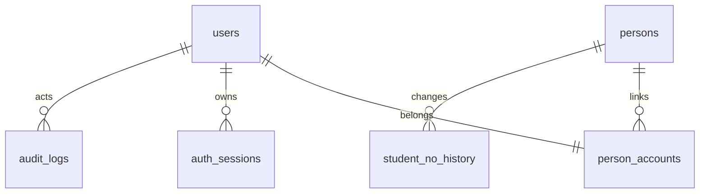

# 数据库说明

当前构建要求迁移 **9**：submissions 允许 javascript/text，global_board_cache 主键为 `(kind,period)`，rejudge_requests 以 `(actor_id,request_key)` 保存幂等回执。题型/判题器位于不可变题面快照，公开读取剔除源码；迁移回退拒绝已有扩展快照或语言提交，见 [批次 6](EXTENSIONS.md)。

迁移 **8**：新增 contest_freezes 封榜历史与 contest_imports 预览/确认状态；其他历史表保持。预览比较解码后的 JSON，确认、批量状态及快照审计同事务。部署恢复包含会话撤销与系统审计，见 [批次 5](OPERATIONS.md)。

迁移 7。新增 community_documents、problem_list_items、problem_list_favorites、discussion_likes、community_write_limits、global_board_cache；内容使用 revision 和软删除，收藏/点赞以 `(document_id,user_id)` 唯一键防重。三榜缓存可从权威事实重建，身份关联和结算会使缓存失效。口径和验收见 [批次 4](COMMUNITY.md)。下文迁移 6 段落保留为此前版本说明。

迁移 6。批次 3 新增 contests、contest_admins、contest_problems、contest_teams、contest_team_members、contest_snapshots、contest_points；persons 增加 organization 与 revision，submissions 增加比赛/队伍引用约束。参赛身份快照、每轮逐点结果及结算积分保留历史；积分主键 `(contest_id, person_id)` 防止重复入账。规则见 [比赛说明](CONTESTS.md)。迁移 6 回退在已有比赛提交时主动拒绝恢复“仅日常提交”约束，避免静默删除历史。

迁移 1 为身份与认证，迁移 2 为题目与不可变版本，迁移 3 为提交与任务基础，迁移 4 为执行重试与死信，迁移 5 为消息隔离；当时（2D）的期望版本为 5。使用 MySQL 8、InnoDB、utf8mb4、BIGINT UNSIGNED 主键，应用写入 UTC DATETIME(6)。数据库实际迁移及约束验收结果见 CHANGELOG.md；运行代码的最新期望版本以 migrations.ExpectedVersion 为准。

## 数据关系

所有历史相关外键使用 RESTRICT，禁止通过级联删除账号、身份、会话或历史记录。首批没有物理删除接口。

## 表与约束

| 表 | 关键字段 | 索引与用途 |
| --- | --- | --- |
| users | username、password_hash、account_type、global_role、status、token_version、created_at/updated_at | username ASCII 二进制唯一索引；规范化由服务端执行；改密增加版本使旧 JWT 失效 |
| persons | display_name、student_no、student_no_status、created_at/updated_at | student_no 可空唯一索引，多个 NULL 合法；保留前导零；状态与是否为空具有 CHECK 约束 |
| person_accounts | user_id、person_id、created_at | user_id 主键保证每账号一个当前身份，person_id 索引允许同一身份关联多个账号 |
| student_no_history | person_id、old/new_student_no、old/new_status、actor_user_id、reason、created_at | (person_id, created_at, id) 支持身份历史顺序查询；初次填写学号也保留记录 |
| auth_sessions | jti_hash、user_id、token_version、expires_at、revoked_at、created_at | jti_hash 唯一；用户与有效期、全局有效期索引；只存 SHA-256 摘要，不存完整 JWT |
| audit_logs | actor_user_id、action、object_type/object_id、request_id、details、created_at | 操作者/时间、对象/时间复合索引；details 为受控 JSON，不存密码、JWT、密钥 |

当前账号类型预留 permanent/contest，公共注册只创建 permanent；角色为 user/super_admin；状态为 active/disabled/retired。比赛管理员将通过比赛授权关系实现。

学号状态：none（空）、pending（待审核）、verified（已审核）、rejected（驳回）。学号归属 persons，不重复存入 users。注册时空白学号转 NULL，非空去首尾空白后设 pending；同学号不会自动匹配、合并或关联身份。

## 事务边界

- **注册**：创建 person → user → person_accounts → 可选初次学号历史 → 审计 → 提交。任一失败回滚；唯一冲突返回 409。并发唯一性以数据库约束兜底。
- **登录**：查找并验证密码后，事务锁定 user，复查状态及 token_version，插入会话与登录审计后提交。签名后的 JWT 只有在会话提交后才返回。
- **退出**：锁定 user，撤销当前 jti 对应会话并记录审计，一起提交。重复撤销不重复写成功审计。
- **改密**：锁定 user 并验证当前会话仍有效，更新哈希与 token_version、撤销该账号全部有效会话、写审计，一起提交。用户锁优先于会话锁，保持统一锁顺序。
- **管理员初始化**：不存在时使用同样的账号创建事务；已存在超级管理员时不修改，普通同名账号返回冲突，不自动提权。

## 迁移与运维

- SQL 嵌入构建产物，通过独立 ojctl 迁移命令执行；Web 启动不隐式改表。
- golang-migrate 的 schema_migrations 保存 version/dirty；无变更视为成功。Web 就绪检查要求版本精确匹配且不 dirty，空库不报告就绪。
- MySQL DDL 不承诺整份迁移事务回滚。失败可能留下部分表及 dirty 状态；应人工检查和修复，禁止自动 Force 清除标记。
- `.down.sql` 仅用于开发环境手动回滚，具有破坏性。正常安装、升级和 Web 不执行 down；生产升级应先备份再执行向前迁移。
- 业务连接禁止 multiStatements；仅独立迁移连接启用。程序通过驱动 DSN 编码器传递密码，不拼接 SQL 或输出连接串。
- 首批不自动清理过期会话或历史，后续应使用按 expires_at 分批处理的受控维护命令；不得删除比赛、提交或必要审计历史。

## 题目与版本（迁移 2）

| 表 | 用途与约束 |
| --- | --- |
| problems | 当前题面 JSON、检索字段、revision、题面/数据版本指针、创建人与时间；status/visibility/difficulty 有 CHECK 约束 |
| problem_versions | (problem_id,version) 主键，不可变题面快照与创建信息 |
| problem_data_versions | (problem_id,data_version) 主键，唯一内部 storage_key、摘要、测试点数/分值/字节统计与导入后的 revision |
| testcases | (problem_id,data_version,case_id) 主键，仅保存每点分值和输入输出长度，不保存正文 |
| tags / problem_tags | 标签唯一名称及题目关联；支持按标签过滤 |

problems 的版本指针使用同题复合外键，不能引用其他题目的版本。创建时在事务内插入空指针、首个快照并设置指针，正常提交后必须有题面版本；数据指针在首次导入前可空，API 表示为 0。编辑新增题面快照并递增 revision；导入在行锁内校验修订号，新增数据版本、测试点元数据、更新指针并写审计。旧版本不可更新或删除。

文件先原子发布再事务登记，数据库提交未知时保留文件，避免误删实际已引用版本；MySQL 始终是可使用版本的事实来源。升级使用向前迁移，备份必须同时覆盖数据库与 problem-data 卷。具体 HTTP 与失败补偿见 [题目管理说明](PROBLEMS.md)。

## 提交与任务（迁移 3）

| 表 | 用途与约束 |
| --- | --- |
| judge_admission | 单行准入锁；串行检查活动任务数，防止并发超出队列容量 |
| submissions | 账号、固定题面/数据版本、Run/Submit、源码/自测输入、当前轮次与结果摘要；64 KiB 正文使用 MEDIUMTEXT/BLOB |
| judge_tasks | 每提交每 generation 唯一任务，attempt 1～4、状态与租约字段 |
| judge_task_outbox | 每 task/attempt 唯一派发意图，事务提交后由 2D 派发至 Redis |
| submission_results | 每提交每 generation 不可变结果，由 Worker 与当前摘要/逐点结果同事务保存 |
| submission_case_results | 每轮逐点状态、分数与资源统计，不保存隐藏输入答案 |

创建事务依次锁准入行、检查活动任务数、复查账号当前状态，再以 FOR SHARE 固定已发布公开题目的版本，写入 submission/task/outbox/audit 后提交。Run 只使用样例或自己的输入，不参与成绩；正式提交要求存在数据版本。比赛字段本批约束为 NULL，比赛模块接入时须向前迁移。2D Worker 使用 generation/attempt/token/有效期 CAS 保存执行状态及结果，结果提交后才 ACK。

## 重试与死信（迁移 4）

| 表/变更 | 用途与约束 |
| --- | --- |
| judge_task_outbox.available_at | 数据库时间控制重试退避；默认当前时间保持初次提交即时可派发；新增 (dispatched_at,available_at,id) 索引 |
| judge_attempt_failures | (task_id,attempt) 唯一失败决策；同题任务身份复合外键；attempt 1～3 只能 retry，4 只能 dead；原因仅允许五种基础设施故障码 |
| judge_dead_letters | 每 task 唯一持久化死信，同时为派发 Outbox；复合外键引用失败记录、CHECK 限定 attempt=4 与受控原因码；派发时间和 Stream ID 成对保存 |

基础设施失败事务先锁 submission、task 并验证有效租约；前 3 次增加 attempt、复位 task/submission、插入下一次 Outbox 与失败记录。第 4 次原子保存 SystemError 终态、零分结果历史、失败记录和死信意图。重试和死信都清理旧租约，不删除旧 attempt 的失败历史，ACK 只能在查询到相应持久化决策或结果后执行。

迁移 4 使用 ALTER TABLE 及新表创建；升级需备份数据库与数据卷，运行 `ojctl migrate up`。MySQL DDL 仍可能部分成功并留下 dirty 状态，应用不会自动 Force。嵌入迁移链测试检查所有 up/down 文件与 ExpectedVersion 一致，不能代替真实 MySQL 迁移及 CHECK/外键验收。

## 消息隔离（迁移 5）与人工重试

judge_message_quarantine 使用 (stream_id,payload_digest) 主键，仅保存 SHA-256 消息摘要、受控原因 invalid_envelope/unresolvable_envelope 和时间，不保存原始源码或输入输出。隔离写入成功后才 ACK；当前活跃任务不能通过无法解析路径被隔离。

`ojctl judge retry` 在准入锁、活跃超级管理员身份检查、submission→task 锁与预期 generation 校验下，新增下一 generation 的任务和 Outbox，复位提交摘要，并同事务记录 judge.retry 审计。旧 generation 结果、失败和死信均保留；提交失败或重放旧 generation 不会生成第二轮任务。Runner 自身的执行 journal 位于 runner-data 文件卷，必须与数据库/题目数据一起纳入运维备份，不能只恢复其中一项而忽略在途任务。

## 真实验证与剩余范围

2D 已在真实 MySQL 8.0.46 验证空库/重复迁移、历史外键、attempt CHECK、Outbox 唯一约束及任务/结果事务，版本 5、dirty=false，具体记录见 CHANGELOG.md。并发身份唯一性压力、真实 dirty DDL 修复、生产数据备份恢复仍需专门验收。sqlmock 本身不能证明真实数据库约束生效。
